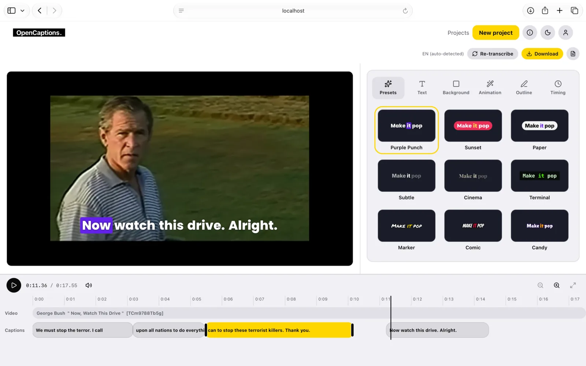

# Introduction

OpenCaptions adds animated, word-by-word captions to a video. It listens to the speech, writes the
words with their timing, lets you style and fix them, and saves the captioned video or subtitle
files. It is free software ([AGPL-3.0](https://github.com/leogaudin/opencaptions/blob/main/LICENSE)),
has no telemetry, and keeps your videos where you put them: on your phone, or on your own server.

## Two ways to use it

| | **The web app, on your server** | **The iPhone and iPad app** |
|---|---|---|
| Runs | In Docker, on your computer, NAS or server | On the phone |
| Speech to text | Whisper or Parakeet on your machine, a GPU box of yours, or the OpenAI API with your key | Whisper, Parakeet or Apple Speech on the phone, or your own server |
| Account | A local account on your instance | None |
| Start here | [Quick start](./getting-started/quick-start.md) | [The iPhone app](./guides/iphone-app.md) |

The two share one caption engine, written in Rust, so a caption looks the same in the browser, on
the server and on the phone. What the preview shows is what the export draws.

## What you get

- **Word-level transcription** in about 100 languages, with the speech model of your choice.
- **Animated looks**: seventeen presets, and a style panel for fonts, colours, outline, background,
  animation and position.
- **A real editor**: fix a misheard word right on the video, retime captions on a timeline, undo
  and redo.
- **Export** a captioned MP4, WebM or ProRes video, SRT, VTT or JSON subtitles, or only the captions
  on a green screen to key out in your video editor.
- **An HTTP API** for everything the app does, with API keys, to put it in a pipeline.
- **Private by design**: no tracking, accounts are local to your instance, and audio leaves your
  machine only if you pick a hosted provider.

## How it works

1. **Add a video.** Upload a file, or give a link.
2. **Get the words.** Choose where to transcribe, the speech model and the spoken language. Each
   word gets its own start and end time.
3. **Pick a look and export.** Choose a style, fix words and timing, then save the captioned video.

[Your first captions](./getting-started/your-first-captions.md) walks through it.

## Status

OpenCaptions is before its first release (v0.1). The interface and the self-hosting setup work today,
but the API and the data formats may still change until the first tagged release.

## Where to go next

- **New here:** [Quick start](./getting-started/quick-start.md), then
  [Your first captions](./getting-started/your-first-captions.md).
- **Running a server:** [Installation](./self-hosting/installation.md),
  [Configuration](./self-hosting/configuration.md) and [Security](./self-hosting/security.md).
- **Building on it:** the [HTTP API](./reference/api.md) and the
  [transcript format](./reference/transcript-format.md).
- **Curious how it is made:** [Architecture](./project/architecture.md) and the
  [speech model benchmarks](./project/speech-model-benchmarks.md).
